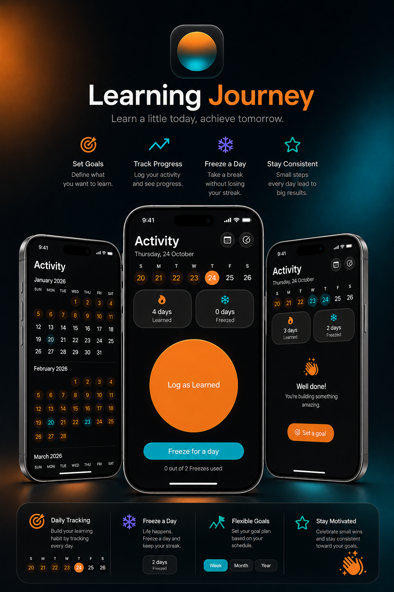

# 🧭 Learning Journey

> Learn a little today, achieve tomorrow.

Learning Journey is an iOS app designed to help learners build a consistent daily learning habit, set learning goals, and track their progress.

## 📱 App Showcase

## ✨ Features

- 🎯 **Set Goals** — Define what you want to learn.
- 📈 **Track Progress** — Log your learning activity and see your progress.
- ❄️ **Freeze a Day** — Take a break without losing your streak.
- ⭐ **Stay Consistent** — Build a daily learning habit and celebrate your progress.

## 🛠 Tech Stack

- Swift
- SwiftUI
- Xcode
- iOS

## 👩🏻‍💻 Project

Created as part of the Apple Developer Academy.
